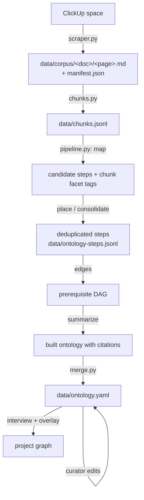
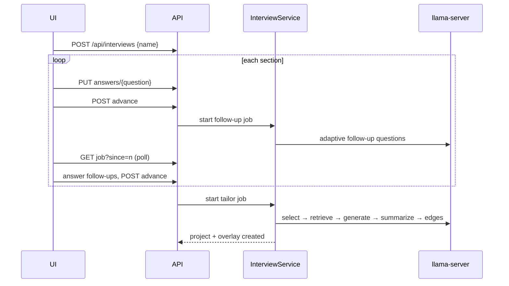

# Architecture

The CoE Build Wizard turns the AI CoE ClickUp knowledge base into a curated, cited graph of
development steps, then tailors that graph for each project through an interview. Everything runs
on one machine: a Python backend, a React frontend that the backend serves, a local LLM, and
plain files under `data/`.

For how to install, scrape, build and serve, see [process.md](process.md).

## System overview

```mermaid
flowchart LR
    subgraph ext[External, outbound only]
        CU[ClickUp REST API<br/>v2 + v3 Docs]
        DL[GitHub / Hugging Face<br/>pinned downloads]
    end

    subgraph host[Local machine]
        subgraph be[Backend: coe-wizard, FastAPI on 127.0.0.1]
            API[HTTP API /api/*]
            SPA[Static SPA host]
            SCR[Scraper]
            INT[Interview + tailoring]
            ED[Ontology editor]
        end
        CLI[CLI: coe-wizard build-ontology]
        LS[llama-server<br/>Qwen3-30B-A3B, Vulkan]
        KR[(OS keyring<br/>OAuth client id/secret)]
        subgraph data[data/ — gitignored]
            CORP[(corpus/ + manifest.json)]
            CH[(chunks.jsonl)]
            ONT[(ontology.yaml)]
            IV[(interview.yaml)]
            PRJ[(projects/*.yaml<br/>interviews/*.yaml)]
            DB[(progress.sqlite3)]
            BK[(backups/)]
        end
    end

    BR[Browser] -->|HTTP| SPA
    BR -->|JSON| API
    SCR -->|rate-limited GET| CU
    SCR --> CORP
    CLI --> CORP
    CLI --> CH
    CLI -->|merge| ONT
    CLI -->|proposals| IV
    CLI -->|lease| LS
    INT -->|lease| LS
    LS -.first run.- DL
    ED --> ONT
    ED --> DB
    INT --> PRJ
    INT --> DB
    API --> KR
```



There are two processes you start, plus one that is started for you:

| Process | Started by | Role |
|---|---|---|
| `coe-wizard serve` | `serve.sh`, `dev.sh`, or `scrape.sh` | Web app, API, ClickUp login and sync, interviews, curation |
| `coe-wizard build-ontology` | `build_ontology.sh` | Offline batch job that chunks the corpus and (re)builds the step graph with the LLM |
| `llama-server` | Whichever of the two above first needs the model | Serves the local model over an OpenAI-compatible HTTP endpoint. Both processes share one instance |

## Design principles

- **Local only.** The backend binds to `127.0.0.1` and serves only its own frontend. The only
  outbound traffic is to ClickUp (on sync, with the user's token) and the one-time pinned
  downloads of llama.cpp and the model. No telemetry, and no hosted LLM.
- **No secrets on disk.** The ClickUp access token (OAuth or personal `pk_…`) is held only in
  backend memory and is lost on restart. OAuth client credentials live in the OS keyring. No
  `.env` or environment-variable secrets are read.
- **Plain files as the database.** The curated graph is hand-editable YAML. Writes are atomic,
  backed up, and guarded by content hashes and file locks, so the CLI and the server can run at
  the same time.
- **The human curator wins.** LLM output is a proposal. Anything a curator edits is locked
  against rebuilds, and anything a curator deletes or rejects is never proposed again.
- **Grounded by default.** Step summaries cite KB chunks, and citations link back to the source
  ClickUp page. Steps written from general knowledge are flagged "Not from KB".

## Repository layout

```
backend/                 Python 3.14 package `coe_wizard` (uv project)
  src/coe_wizard/
    cli.py               argparse entry point: `serve`, `build-ontology`
    app.py               FastAPI factory, SPA mounting, lifespan cleanup
    config.py            Settings: data paths, workspace/space ids, ports
    services.py          Wires long-lived objects together (the DI container)
    api.py               /api routes: auth, sync, projects, progress, ontology edits
    interview_api.py     /api routes: local model, interviews, overlays, interview definition
    auth.py              OAuth + personal-token login, keyring credential store
    clickup.py           Rate-limited ClickUp REST client
    scraper.py           Incremental ClickUp Docs → Markdown corpus sync
    chunks.py            Corpus → citeable chunks with stable ids
    facets.py            Facet matching between tags and interview answers
    jobs.py              Background job with a pollable progress log
    state.py             SQLite progress DB (projects, completion, checklist ticks)
    progress_view.py     Combines graph + progress into the view the UI renders
    llm.py               LLMBackend protocol + llama-server JSON-schema client
    llm_server.py        Download/verify llama.cpp + model; shared server leases
    fake_llm.py          Scripted model for end-to-end tests
    ontology/
      model.py           Pydantic schema for the DAG (nodes, edges, rejected) + cycle checks
      store.py           YamlStore: atomic, hashed, locked, backed-up YAML persistence
      pipeline.py        LLM map → place → consolidate → edges → summarize
      merge.py           Merge a fresh build into the curated graph
      editor.py          Curator edits (each one locks what it touches)
    interview/
      seed.yaml          Committed default interview, copied to data/interview.yaml
      definition.py      Interview schema, proposed questions/options
      engine.py          LLM follow-ups and project tailoring
      overlay.py         Per-project overlay schema, composition, overlay edits
      service.py         Interview drafts and the jobs that advance them
  tests/                 pytest suite (respx-mocked HTTP, no network)
frontend/                Vite 8 + React 19 + TypeScript SPA
  src/main.tsx           Router + React Query + edit-mode provider
  src/api.ts             Typed client for /api
  src/pages/             Projects, Graph, Node, Interview, Login
  src/components/        DAG view, summary/citations, sync indicator, editor dialogs, shadcn/ui
  src/lib/               Hooks (optimistic progress), frontier ordering, edit mode
  e2e/                   Playwright specs + fixture data
*.sh                     Entry-point scripts (see process.md)
data/                    Runtime data (gitignored)
.cache/                  llama.cpp build + GGUF model (gitignored)
```

## Data pipeline



### 1. Scrape (`scraper.py`, `clickup.py`)

- The target workspace and space ids are constants in `config.py`.
- The ClickUp v3 Docs endpoint only filters by direct parent, so the scraper enumerates the space,
  each folder and each list, then queries docs under each one. Pages are fetched as Markdown
  (`content_format=text/md`) and flattened.
- **Incremental.** A doc is skipped when its `date_updated` matches the manifest. Within a doc, a
  page is rewritten only if its SHA-256 changed. Docs and pages that disappear are marked
  `deleted` in the manifest rather than removed, so citations to them can be shown as broken.
- The manifest is saved after every doc, so an interrupted sync keeps its progress.
- **Rate limiting.** A token bucket (`--rpm` / `COE_RPM`, default 60/min) also reads ClickUp's
  `X-RateLimit-Remaining/Reset` headers and pauses until reset when nearly out. 429 and 5xx
  responses back off exponentially with jitter, up to 6 retries.
- Sync runs as a background `SyncJob` in the server. The UI's sync indicator and `scrape.sh` both
  poll `GET /api/sync?since=n` for incremental log lines.

### 2. Chunk (`chunks.py`)

Each live page is split on headings, then paragraphs are packed into chunks of about 1,500
characters. A chunk id is `sha256(doc/page + normalized text)[:16]`, so it stays stable across
rebuilds as long as the text is unchanged. Citations reference chunk ids, and facet tags from
earlier builds carry over to unchanged chunks.

### 3. Build the ontology (`ontology/pipeline.py`)

A map-reduce pipeline against the local model. Every call returns one small JSON object, and ids
are constrained to an enum of the valid values, so replies never have to restate the whole graph:

| Stage | Per | Output |
|---|---|---|
| map | chunk | Candidate steps (title, description, checklist), plus facet tags for the chunk and proposed new facet values |
| place | candidate | Match to an existing step (which is then rewritten to fold the candidate in) or "new". Existing node ids are offered so rebuilds keep ids stable. Progress is mirrored to `data/ontology-steps.jsonl` |
| consolidate | step, up to 3 passes | Merge duplicates until a pass merges nothing |
| edges | node | Direct prerequisites with confidence. Cycles are broken by dropping the lowest-confidence edge |
| summarize | node | 150–400 word Markdown summary over its source chunks. `[S#]` markers become `[n]` citations |
| propose questions | build | Up to 3 new interview questions suggested by the corpus |

A node's facets are the union of its source chunks' facet tags. Empty facets mean the step is
universal and applies to every project.

### 4. Merge (`ontology/merge.py`)

A fresh build is merged into `data/ontology.yaml`, re-read under the file lock so edits made during
the build survive:

- **First build:** taken as-is, all accepted.
- **Locked fields** (`title`, `checklist`, `citations`, `facets`) are never overwritten.
  Summaries are LLM-owned and always refresh. If citations are locked, the fresh summary's markers
  are remapped onto the locked citations by chunk id.
- **New** nodes and edges arrive as `proposed`, unless they are listed in `rejected`.
- **Stale proposals** that the LLM no longer produces are dropped, unless they carry locked fields.
  Accepted items are never removed by a rebuild.
- Proposed edges that would close a cycle are skipped.

## Domain model

### Ontology (`data/ontology.yaml`, `ontology/model.py`)

```yaml
version: 1
nodes:
  - id: security-review            # slug, stable across rebuilds
    title: Conduct a security review
    summary: "… [1] … [2]"           # Markdown with [n] markers
    checklist: [{id: 3f2a…, text: …}] # id = hash of normalized text
    citations: [{n: 1, chunk_id: …, excerpt: …, url: …, doc_title: …}]
    facets: {app_type: [llm-app]}     # {} = universal
    grounded: true                    # false = "Not from KB"
    status: accepted                  # or proposed
    locked_fields: [title]
edges:
  - {from: system-design, to: security-review, status: accepted, locked: false}
rejected:
  nodes: [old-step]
  edges: [[a, b]]
```

The validator rejects duplicate ids, dangling edges, self-loops and cycles. A hand edit that breaks
these rules makes the API return `503 invalid_ontology`, and the UI shows the error.

### Interview and facets (`data/interview.yaml`, `interview/definition.py`)

The interview is organized as sections of questions. A choice question marked `facet: true` is a
**facet dimension**, and its option values are the facet's values. The build tags chunks and nodes
with these values. A project's answers then select matching steps: dimensions are ANDed, values
within a dimension are ORed, and dimensions the project left unanswered are ignored
(`facets.py`). Builds add `proposed` questions and options, which follow the same
lock/reject rules as the ontology.

### Projects and overlays (`data/projects/<id>.yaml`, `interview/overlay.py`)

A project's graph is composed at request time:

```
visible global = accepted global steps that are explicitly included, universal, or facet-matching
                 − excluded − global copies of steps this project promoted
+ generated    = project-only steps (ids start with "gen."), produced by tailoring
+ bridges      = A → B wherever the global graph has A → (hidden steps) → B
```

Projects created before interviews existed have no overlay and see the whole global graph.
Re-tailoring a project runs the interview again and writes the differences as project proposals
for the user to accept or reject. A generated step can be **promoted** into the global ontology.

### Progress (`data/progress.sqlite3`, `state.py`)

| Table | Key | Fields |
|---|---|---|
| `projects` | `id` | `name`, `created_at` |
| `node_progress` | `(project_id, node_id)` | `completed`, `hidden` |
| `checklist_progress` | `(project_id, node_id, item_id)` | `checked` |

Progress is keyed by node id and checklist item id, which are both stable, so it survives rebuilds.
Curator edits keep progress consistent in the same transaction. **Merge** moves progress to the
surviving node (completion ORed, ticks unioned), **delete** hides it, and re-creating a node with
the same id restores it. Migrations are an ordered list applied on startup. WAL mode is enabled.

### Wizard state (`progress_view.py`)

Each node is `complete` if the user checked it off. It is `frontier` if it is accepted and every
accepted prerequisite is complete. Otherwise it is `locked`. Only accepted edges gate progress.
Proposed items are shown in edit mode only. Citations whose chunk no longer exists are marked
`broken`.

## Interviews and tailoring (`interview/`)



- Drafts are stored in `data/interviews/<id>.yaml` until completion. The project and its overlay
  are created together only when the interview finishes.
- Tailoring (`engine.py`) first filters accepted global steps by facets and asks the LLM in batches
  which ones the project needs. It then retrieves facet-matching chunks, generates up to 5
  project-specific steps that cite them (flagged ungrounded if no passage supports a step),
  summarizes them, and infers their prerequisites.
- Every LLM step runs as a `SyncJob` that the UI polls.

## Local LLM (`llm.py`, `llm_server.py`)

- **Abstraction.** Callers depend only on `LLMBackend.complete(prompt, json_schema) -> dict`.
  Implementations are `LlamaServerBackend` (OpenAI-compatible `/v1/chat/completions` with a
  strict `json_schema` response format, which llama-server compiles to a grammar) and
  `FakeProvider` for tests. Truncated or unparseable replies are retried up to 4 times.
- **Providers.** `ManagedProvider` downloads, starts and shares the bundled server.
  `ExternalProvider` uses any running OpenAI-compatible server (`LLAMA_URL` / `--llama-url`).
- **Pinned and verified.** llama.cpp `b11430` (Ubuntu x64 Vulkan build) and
  `Qwen3-30B-A3B-Instruct-2507-Q4_K_M.gguf` are SHA-256 checked once. A `.verified` marker avoids
  re-hashing about 18 GB on each start. Downloads resume.
- **Sharing.** A JSON lock file in `.cache/` (guarded by `fcntl`) records the server's pid and
  port and a set of leases. The first process that needs the model starts `llama-server` in its own
  session. Leases held by dead processes are ignored. When the last lease is released, the server
  stops after `--llm-idle-timeout` (default 600 s) in the app, or immediately from the CLI.
- **Download consent.** In the app, the model is only downloaded after the user clicks Download
  on the interview page. `build_ontology.sh` downloads it automatically.

## Persistence and concurrency

`YamlStore` (`ontology/store.py`) is used for the ontology, the interview definition, overlays and
interview drafts:

- **Round-trip YAML** (ruamel). New data is merged onto the old document, matching list items by
  `id`, so hand-written comments and key order survive app edits.
- **Optimistic concurrency.** Every read returns a 16-character content hash. Edit requests send
  it as `If-Match`, and a mismatch returns `409 stale` with the current hash so the UI can
  refetch.
- **Cross-process lock.** `fcntl.flock` on `<file>.lock` serializes the server and the build CLI.
  The builder passes `expected_hash=None` and holds the lock for its whole read-merge-write.
- **Atomic writes and backups.** Each write goes to a temp file followed by `os.replace`. The
  previous version is copied to `data/backups/<prefix>-<timestamp>.yaml` first, and the last 100
  backups are kept per prefix.
- **YAML + SQLite consistency.** Edits that also change progress run the YAML update inside a
  `ProgressDB.transaction()`, so a failed write rolls back the SQL changes.

## HTTP API

All routes are under `/api`. Ontology and overlay mutations require `If-Match`.

| Area | Routes |
|---|---|
| Auth | `GET auth/status`, `POST auth/setup` (OAuth client → keyring), `POST auth/token` (personal token), `GET auth/login`, `GET auth/callback`, `POST auth/logout` |
| Sync | `POST sync` (202, or 409 if already running), `GET sync?since=n` |
| Projects | `GET projects`, `GET/PATCH/DELETE projects/{id}`, `GET projects/{id}/graph?edit=`, `PUT …/nodes/{nid}/complete`, `PUT …/nodes/{nid}/checklist/{item}` |
| Ontology | `GET ontology/status`, `GET chunks?q=`, `POST/PATCH/DELETE ontology/nodes…`, `POST …/merge`, `PUT …/checklist`, `PUT …/citations`, `POST …/resolve`, `POST/DELETE ontology/edges…` |
| Local model | `GET llm/status`, `POST llm/download`, `POST llm/download/cancel`, `POST llm/warm` |
| Interviews | `GET/POST interviews`, `GET/PATCH/DELETE interviews/{id}`, `PUT …/answers/{q}`, `POST …/advance`, `GET …/job` |
| Tailoring | `POST projects/{id}/retailor`, `POST …/proposals/{key}/resolve`, `POST …/nodes/{nid}/promote`, `…/overlay/nodes…`, `…/overlay/edges…` |
| Interview definition | `GET interview-def?edit=`, `POST …/questions/{q}/resolve`, `POST …/questions/{q}/options/{v}/resolve` |

When started with `--static-dir`, the app serves `/assets` and returns `index.html` for any other
non-API path, so client-side routes work on reload.

## Frontend (`frontend/`)

- **Stack.** Vite 8, React 19, TypeScript, React Router 7, TanStack Query, `@xyflow/react` with
  dagre for DAG layout, Tailwind 4 with shadcn/ui (Radix), and `react-markdown` with
  `rehype-sanitize` for summaries.
- **Routes.** `/projects` (list, drafts, new interview), `/projects/:pid` (DAG), `/projects/:pid/nodes/:nid`
  (summary, checklist, completion, citation side panel, previous/next through the frontier in
  topological order), `/interviews/:iid`, `/login`.
- **State.** All server state goes through React Query. Progress toggles are optimistic and roll
  back on failure. A global **Edit mode** switch requests `?edit=true` views (proposals visible)
  and exposes the editor dialogs. Ontology edits carry the last-seen hash and refetch on `409`.
- **Dev vs. prod.** In production the backend serves `frontend/dist`. In development, Vite on
  `:5173` proxies `/api` to `:8765`, and the backend is told `--public-url` so OAuth redirects
  return through Vite.

## Security model

| Concern | Approach |
|---|---|
| Network exposure | Loopback bind only. No CORS and no remote clients |
| ClickUp token | Process memory only. Personal tokens are passed to `scrape.sh` on stdin, never in argv |
| OAuth app credentials | OS keyring (`coe-wizard-clickup`). The `--memory-credentials` flag is for tests |
| OAuth CSRF | Single-use `state` with a 10-minute TTL |
| Scraped content | `data/` is gitignored because it is internal ClickUp content. `.graphifyignore` keeps it out of the code graph |
| Supply chain | llama.cpp and model downloads are pinned to exact versions and SHA-256 checked |
| Rendered Markdown | Sanitized with `rehype-sanitize` |
| Static files | Path traversal is blocked (`is_relative_to(static_dir)`) |

## Testing

- **Backend:** `pytest` (HTTP mocked with `respx`), `ruff`, and `pyright` (standard mode).
- **Frontend:** `eslint`, `tsc -b`, and Playwright e2e. The e2e suite builds the SPA and runs the
  real backend on port 8799 against a fresh copy of `frontend/e2e/fixtures`, with
  `--memory-credentials --fake-llm`. It needs no ClickUp access and no GPU. Specs run serially
  because they share one mutable backend.

## Known limitations

- Prototype quality (see the README).
- One hard-coded ClickUp workspace and space (`config.py`).
- The managed llama.cpp build is Linux x64 + Vulkan only. Other platforms need `LLAMA_URL`.
- Logins don't survive a backend restart (by design).
- The chunk search used by the citation editor is a substring scan, not semantic retrieval.
- `data/` is not versioned. Back it up yourself.
